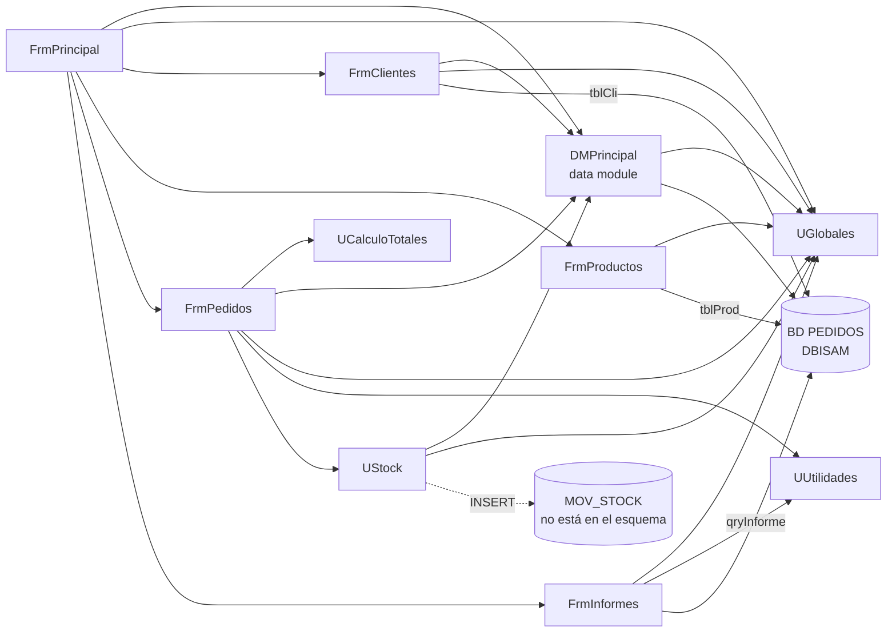

# Dependencias de Pedidos Legado

> Etapa 1 · Entender. Una flecha `A --> B` significa «A usa a B»: sale de la cláusula `uses` de cada `.pas`.
> Las flechas a la base salen de los componentes DBISAM de los `.dfm`. El SQL de `FrmPedidos`, `FrmClientes` y `UStock` se ejecuta con las consultas de `DMPrincipal` (`qryGeneral`, `qryAux`, `EjecutarSQL`), por eso llega a la base a través del data module.

## Preguntas guía

1. **¿Qué unidad usan casi todas las demás? ¿Qué pasaría si cambia?**
   `UGlobales`: la usan 7 de las 9 unidades (todas menos `UCalculoTotales` y `UUtilidades`). Son variables globales que, según su propio comentario, «se modifican desde varios formularios» (`UGlobales.pas:3-4`); un cambio ahí puede afectar a casi todo el sistema y es difícil saber dónde.
2. **¿Qué unidad no depende de formularios ni de la base de datos? ¿Por qué eso importa para migrar?**
   `UGlobales` no depende de nada. `UCalculoTotales` y `UUtilidades` solo usan `SysUtils` y `DateUtils`: no dependen de formularios, del data module ni de la base. Son lógica pura que se puede migrar y probar con tests sin arrastrar la interfaz ni la base; son las primeras candidatas.
