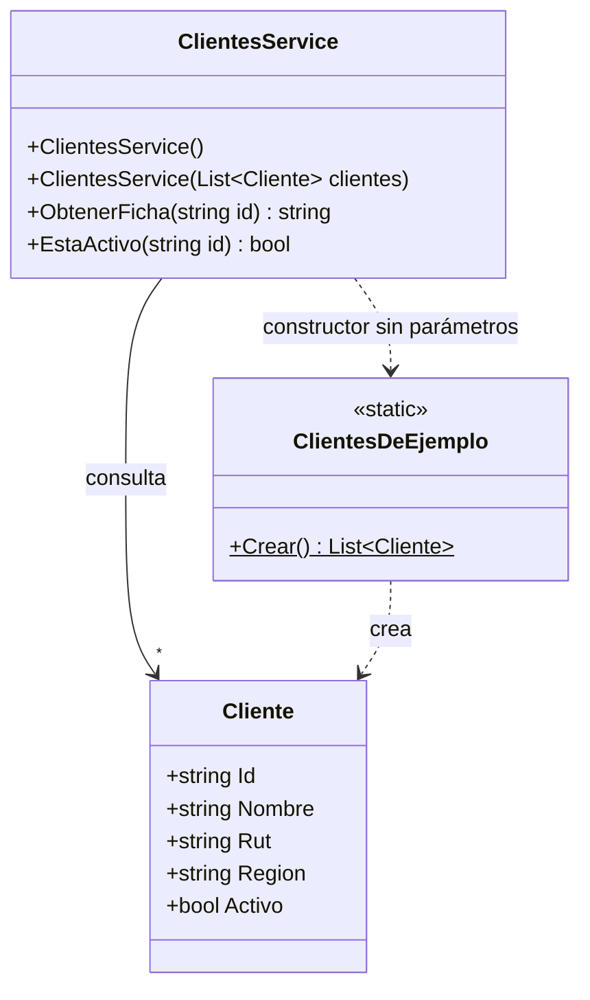

# ClientesService

`src/PedidosWeb.Core/Clientes/ClientesService.cs` · namespace `PedidosWeb.Core.Clientes`

## Propósito

Responde dos consultas sobre los clientes de la distribuidora para la pantalla:

- **La ficha del cliente**: un texto de una línea con nombre, RUT normalizado, zona comercial y estado.
- **Si el cliente está activo.**

Es un módulo heredado, escrito por un ex integrante del equipo. Se ordenó (nombres claros, métodos extraídos) sin cambiar su comportamiento, y los tests de caracterización de `ClientesServiceTests` fijan ese comportamiento.

Trabaja sobre una lista de clientes en memoria. Si no se le entrega ninguna, usa los 8 clientes de `ClientesDeEjemplo`.

## API pública

### Constructores

| Firma | Qué hace |
|---|---|
| `ClientesService()` | Usa los 8 clientes de ejemplo (`ClientesDeEjemplo.Crear()`). |
| `ClientesService(List<Cliente> clientes)` | Usa la lista que recibe. Guarda la referencia a esa lista sin copiarla. |

### `string ObtenerFicha(string id)`

Devuelve la ficha del cliente con el formato:

```
Nombre | RUT | Zona | Activo/Inactivo
```

- **Cliente inexistente** → `""` (texto vacío, no `null`).
- **Búsqueda por id**: comparación exacta (distingue mayúsculas y minúsculas). Si hay varios clientes con el mismo id, usa el primero.
- **RUT**: quita los puntos y los espacios y pasa la «k» a mayúscula. Los RUT del legado vienen escritos de varias formas:

  | RUT guardado | En la ficha |
  |---|---|
  | `76.123.456-0` | `76123456-0` |
  | `76.990.011-k` | `76990011-K` |
  | `76 432 198-7` | `76432198-7` |
  | `77654321-7` | `77654321-7` |

  No valida el dígito verificador: solo cambia el formato.
- **Zona**, según el campo `Region` (comparación exacta del texto):

  | Región | Zona |
  |---|---|
  | `RM`, `V` | Zona centro |
  | `VIII` | Zona sur |
  | `II` | Zona norte |
  | cualquier otra (por ejemplo `XII`) | Sin zona |

- **Estado**: `Activo` si `Cliente.Activo` es `true`; si no, `Inactivo`.

### `bool EstaActivo(string id)`

- Cliente existe y está activo → `true`.
- Cliente existe y está inactivo → `false`.
- Cliente inexistente → `false`. No distingue entre "inactivo" y "no existe".

### Tipo `Cliente`

`Cliente` (`src/PedidosWeb.Core/Clientes/Cliente.cs`) tiene las propiedades `Id`, `Nombre`, `Rut`, `Region` (todas `string`, `""` por defecto) y `Activo` (`bool`). Todos los datos son ficticios.

## Ejemplo de uso

```csharp
using PedidosWeb.Core.Clientes;

// Con los 8 clientes de ejemplo
var servicio = new ClientesService();

servicio.ObtenerFicha("C-001");  // "Ferretería El Clavo | 76123456-0 | Zona centro | Activo"
servicio.ObtenerFicha("C-007");  // "Kiosco Central | 77321654-1 | Zona sur | Inactivo"
servicio.ObtenerFicha("C-999");  // ""

servicio.EstaActivo("C-001");    // true
servicio.EstaActivo("C-007");    // false (inactivo)
servicio.EstaActivo("C-999");    // false (no existe)

// Con una lista propia, por ejemplo en un test
var otro = new ClientesService(new List<Cliente>
{
    new() { Id = "C-100", Nombre = "Cliente Austral", Rut = "11.111.111-1", Region = "XII", Activo = true }
});

otro.ObtenerFicha("C-100");      // "Cliente Austral | 11111111-1 | Sin zona | Activo"
```

## Diagrama



## Tests

`tests/PedidosWeb.Core.Tests/Clientes/ClientesServiceTests.cs` cubre: cliente inexistente, cliente activo, RUT con puntos y «k» minúscula, RUT sin puntos y con espacios, las tres zonas, cliente inactivo, región desconocida (`Sin zona`) y `EstaActivo` en sus tres casos.

## Preguntas abiertas

El código no responde estas preguntas y los tests no las cubren:

- **`id` nulo**: `ObtenerFicha(null)` y `EstaActivo(null)` devuelven `""` y `false` (ningún cliente coincide). ¿Es el comportamiento esperado o se debería rechazar?
- **`Rut` nulo**: si un cliente tiene `Rut = null`, `ObtenerFicha` lanza `NullReferenceException`. ¿Puede pasar con datos reales del legado?
- **Región en minúsculas o con espacios** (`"rm"`, `" V"`): hoy devuelve `Sin zona`. ¿El legado guarda las regiones siempre en ese formato?
- **Faltan regiones**: solo hay zona para `RM`, `V`, `VIII` y `II`. ¿Las demás regiones del país son "Sin zona" a propósito, o el mapeo está incompleto?
- **Uso desde la API**: `Program.cs` no expone ningún endpoint de clientes. ¿Quién consume este servicio hoy?
